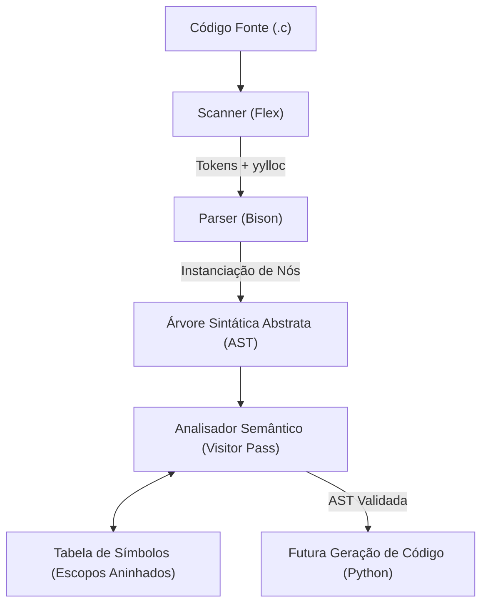

# Árvore Sintática Abstrata (AST) e Tabela de Símbolos

Este documento descreve a implementação da **Árvore Sintática Abstrata (AST)**, da **Tabela de Símbolos** e do **Analisador Semântico** do compilador, desenvolvido na linguagem C para a disciplina de Compiladores (UnB).

---

## 1. Visão Geral da Arquitetura

O compilador adota o modelo clássico de processamento em fases desacopladas (*multi-pass*):



1. **Scanner (`src/scanner.l`)**: Realiza a análise léxica, emitindo tokens e rastreando posições de linha e coluna.
2. **Parser (`src/parser.y`)**: Reconhece a sintaxe através da gramática livre de contexto e constrói a AST diretamente na memória.
3. **AST (`src/ast.h`, `src/ast.c`)**: Estrutura em árvore que representa hierarquicamente o código-fonte livre de ruídos sintáticos (como `;`, parênteses ou delimitadores).
4. **Tabela de Símbolos (`src/symtab.h`, `src/symtab.c`)**: Armazena os identificadores (variáveis, funções, structs e parâmetros) associados a tipos e níveis de escopo.
5. **Analisador Semântico (`src/semantic.h`, `src/semantic.c`)**: Percorre a AST, popula e consulta a tabela de símbolos e aplica as checagens de escopo, tipos e fluxo.

---

## 2. Árvore Sintática Abstrata (AST)

### 2.1 Estrutura de Dados do Nó

Adotou-se o padrão mais simples e canônico em C: uma **única struct unificada** (`ASTNode`) com campos flexíveis e ponteiros estruturados:

```c
typedef struct ASTNode {
    ASTNodeType type;
    int line;
    int column;
    DataType data_type;       /* Tipo de dado da declaração ou inferido na expressão */

    /* Valores literais e identificadores */
    char *name;               /* Identificador, função, struct ou campo */
    int int_val;              /* Literais inteiros e booleanos */
    float float_val;          /* Literais de ponto flutuante */
    char char_val;            /* Literais de caractere */
    char *str_val;            /* Literais de string */
    int op;                   /* Código do operador (ex: OP_PLUS, OP_EQ) */

    /* Filhos estruturados */
    struct ASTNode *left;     /* Filho esquerdo (condição, lado esquerdo de binop) */
    struct ASTNode *right;    /* Filho direito (corpo then, lado direito de binop) */
    struct ASTNode *extra;    /* Terceiro filho (else em if, passo em for) */

    /* Encadeamento de listas */
    struct ASTNode *next;     /* Próximo nó irmão (comandos, parâmetros, argumentos) */
} ASTNode;
```

### 2.2 Categorias de Nós (`ASTNodeType`)

- **Estruturais**: `AST_PROGRAM`, `AST_BLOCK`, `AST_EXPR_STMT`.
- **Declarações**: `AST_VAR_DECL`, `AST_FUNC_DEF`, `AST_PARAM_DECL`, `AST_STRUCT_DECL`.
- **Comandos de Controle**: `AST_IF`, `AST_WHILE`, `AST_FOR`, `AST_SWITCH`, `AST_CASE`, `AST_DEFAULT`, `AST_BREAK`, `AST_CONTINUE`, `AST_RETURN`.
- **Expressões**: `AST_BIN_OP`, `AST_UN_OP`, `AST_ASSIGN`, `AST_CALL`, `AST_ARRAY_ACCESS`, `AST_MEMBER_ACCESS`.
- **Literais / Folhas**: `AST_IDENTIFIER`, `AST_LIT_INT`, `AST_LIT_FLOAT`, `AST_LIT_CHAR`, `AST_LIT_STRING`, `AST_LIT_BOOL`.

### 2.3 Integração com o Bison

Cada regra sintática de `src/parser.y` instancia o nó correspondente de baixo para cima (*bottom-up*):

```yacc
expression
    : expression OP_PLUS expression {
        $$ = ast_create_bin_op(OP_PLUS, $1, $3, @2.first_line, @2.first_column);
    }
    | IDENTIFIER {
        $$ = ast_create_identifier($1, @1.first_line, @1.first_column);
        free($1);
    }
    ;
```

---

## 3. Tabela de Símbolos e Escopos

### 3.1 Gerenciamento de Escopos Aninhados

A tabela organiza os identificadores em uma hierarquia de escopos em cadeia:
- **Nível 0 (Global)**: Funções, structs e variáveis globais.
- **Nível 1 (Função)**: Parâmetros formais e corpo da função.
- **Nível 2+ (Blocos Aninhados)**: Variáveis declaradas dentro de blocos `{}` em `if`, `while`, `for`.

Cada escopo possui uma tabela hash com resolução por encadeamento e um ponteiro para o escopo `parent`:

```c
typedef struct Scope {
    int level;
    struct Scope *parent;
    Symbol *buckets[SYMTAB_HASH_SIZE];
    struct Scope **children;
    int child_count;
} Scope;
```

### 3.2 Resolução Léxica de Símbolos

- **`symtab_lookup_local(scope, name)`**: Busca **apenas** no escopo corrente. Utilizado para detectar redeclarações inválidas no mesmo nível.
- **`symtab_lookup(scope, name)`**: Busca no escopo corrente e, se não encontrar, sobe recursivamente para os escopos pais até o escopo global. Permite sombreamento (*shadowing*) de variáveis sem conflito.
- **`symtab_lookup_member(struct_scope, member)`**: Busca um membro dentro do namespace particular de uma struct.

---

## 4. Análise Semântica e Verificação de Tipos

A análise semântica é realizada em duas passadas sobre a AST:

1. **Passo 1 (Coleta de Declarações Globais)**:
   - Registra no escopo global todas as structs e assinaturas de funções.
   - Permite que funções se chamem livremente e que structs sejam referenciadas em tipos de retorno ou parâmetros.

2. **Passo 2 (Verificação Completa de Escopos e Tipos)**:
   - **Resolução de Identificadores**: Garante que variáveis, funções e membros acessados foram previamente declarados.
   - **Checagem de Redeclarações**: Impede a declaração duplicada de variáveis ou parâmetros no mesmo escopo.
   - **Sistema de Tipos e Coerção**:
     - Tipos idênticos são aceitos diretamente.
     - Permite promoção implícita de `int` para `float` em atribuições e operações aritméticas mistas.
     - Expressões relacionais e lógicas resultam estritamente no tipo `bool`.
   - **Chamadas de Função**: Confere aridade (quantidade de argumentos) e tipos dos argumentos em relação aos parâmetros formais.
   - **Acesso a Structs**: Valida se a base da operação `.` é uma struct e se o membro existe em sua definição.
   - **Arrays**: Valida se a base da indexação `[]` é um vetor e se o índice é do tipo inteiro.
   - **Desvios de Fluxo**:
     - `break`: permitido apenas dentro de laços de repetição (`while`, `for`) ou `switch`.
     - `continue`: permitido apenas dentro de laços de repetição.
     - `return`: confere se o valor retornado é compatível com o tipo de retorno da função corrente (e rejeita retornos com valor em funções `void`).

---

## 5. Interface de Linha de Comando (CLI)

O executável `./compilador` oferece as seguintes opções:

| Flag | Descrição |
|---|---|
| `-s`, `--scan` | Executa apenas o Scanner e imprime a lista formatada de tokens (padrão). |
| `-p`, `--parse` | Executa o Parser e valida a conformidade sintática do arquivo. |
| `-a`, `--ast` | Executa o Parser e imprime a Árvore Sintática Abstrata (AST) formatada. |
| `-t`, `--symbols` | Executa o Parser e a análise semântica, exibindo a Tabela de Símbolos hierárquica. |
| `-c`, `--check` | Executa a validação sintática e semântica completa, retornando código `0` em caso de sucesso ou `1` se houver erros. |

### Exemplo de Uso

#### Visualização da AST:
```bash
./compilador --ast tests/example.c
```
*Saída gerada:*
```text
FuncDef: main (Return: int)
  Body:
    Block
      VarDecl: salario (Type: float)
        Init:
          LiteralFloat: 1250.500000
      VarDecl: letra (Type: char)
        Init:
          LiteralChar: 'A'
      VarDecl: mensagem (Type: char[])
        Init:
          LiteralString: "Olá, Compiladores!"
      If
        Cond:
          BinOp: >
            Identifier: salario
            LiteralFloat: 1000.000000
        Then:
          Block
            ExprStmt
              Assign: +=
                Identifier: salario
                LiteralFloat: 150.000000
      Return
        LiteralInt: 0
```

#### Visualização da Tabela de Símbolos:
```bash
./compilador --symbols tests/example.c
```
*Saída gerada:*
```text
--- Escopo Nível 0 ---
  [FUNC] main -> Retorno: int, Parâmetros: 0 (Linha: 2)
  --- Escopo Nível 1 ---
    --- Escopo Nível 2 ---
      [VAR] letra : char (Linha: 4)
      [VAR] salario : float (Linha: 3)
      [VAR] mensagem : char[] (Linha: 5)
      --- Escopo Nível 3 ---
```

---

## 6. Testes Automatizados

O projeto conta com suítes de testes automatizadas em Python cobrindo todos os módulos:

- **Testes Léxicos**: `tests/run_tests.py` (11 testes)
- **Testes da AST**: `tests/test_ast.py` (6 testes)
- **Testes Semânticos**: `tests/test_semantic.py` (12 testes)

Para rodar toda a bateria de testes:
```bash
make test
```
Resultando em 29 testes aprovados (100% de sucesso).
