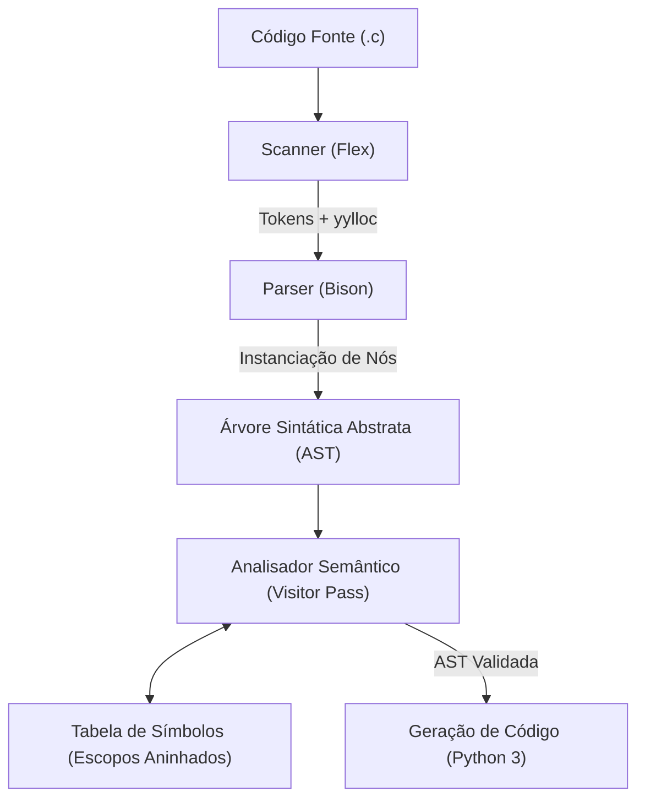

# Árvore Sintática Abstrata (AST) e Tabela de Símbolos

Este documento descreve a implementação da **Árvore Sintática Abstrata (AST)**, da **Tabela de Símbolos** e do **Analisador Semântico** do compilador, desenvolvido na linguagem C para a disciplina de Compiladores (UnB).

---

## 1. Visão Geral da Arquitetura

O compilador adota o modelo clássico de processamento em fases desacopladas (*multi-pass*):



1. **Scanner (`src/scanner.l`)**: Realiza a análise léxica, emitindo tokens e rastreando posições de linha e coluna.
2. **Parser (`src/parser.y`)**: Reconhece a sintaxe através da gramática livre de contexto e constrói a AST diretamente na memória.
3. **AST (`src/ast.h`, `src/ast.c`)**: Estrutura em árvore que representa hierarquicamente o código-fonte livre de ruídos sintáticos (como `;`, parênteses ou delimitadores).
4. **Tabela de Símbolos (`src/symtab.h`, `src/symtab.c`)**: Armazena os identificadores (variáveis, funções e parâmetros) associados a tipos e níveis de escopo.
5. **Analisador Semântico (`src/semantic.h`, `src/semantic.c`)**: Percorre a AST, popula e consulta a tabela de símbolos e aplica as checagens estáticas de tipos, escopo, fluxo de controle e ponto de entrada.

---

## 2. Árvore Sintática Abstrata (AST)

### 2.1 Estrutura de Dados do Nó

Adotou-se o padrão mais simples e canônico em C: uma **única struct unificada** (`ASTNode`) com campos flexíveis e ponteiros estruturados:

```c
typedef struct ASTNode {
    ASTNodeType type;
    int line;
    int column;
    DataType data_type;       /* Tipo de dado da declaração ou inferido na expressão */

    /* Valores literais e identificadores */
    char *name;               /* Identificador ou nome de função */
    int int_val;              /* Literais inteiros e booleanos */
    float float_val;          /* Literais de ponto flutuante */
    char char_val;            /* Literais de caractere */
    char *str_val;            /* Literais de string */
    int op;                   /* Código do operador (ex: OP_PLUS, OP_EQ) */

    /* Filhos estruturados */
    struct ASTNode *left;     /* Filho esquerdo (condição, lado esquerdo de binop, inicializador) */
    struct ASTNode *right;    /* Filho direito (corpo then, lado direito de binop) */
    struct ASTNode *extra;    /* Terceiro filho (else em if, passo em for) */

    /* Encadeamento de listas */
    struct ASTNode *next;     /* Próximo nó irmão (comandos, parâmetros, argumentos) */
} ASTNode;
```

### 2.2 Categorias de Nós (`ASTNodeType`)

- **Estruturais**: `AST_PROGRAM`, `AST_BLOCK`, `AST_EXPR_STMT`.
- **Declarações**: `AST_VAR_DECL`, `AST_FUNC_DEF`, `AST_PARAM_DECL`.
- **Comandos de Controle**: `AST_IF`, `AST_WHILE`, `AST_FOR`, `AST_BREAK`, `AST_CONTINUE`, `AST_RETURN`.
- **Expressões**: `AST_BIN_OP`, `AST_UN_OP`, `AST_ASSIGN`, `AST_CALL`, `AST_ARRAY_ACCESS`.
- **Literais / Folhas**: `AST_IDENTIFIER`, `AST_LIT_INT`, `AST_LIT_FLOAT`, `AST_LIT_CHAR`, `AST_LIT_STRING`, `AST_LIT_BOOL`.

### 2.3 Integração com o Bison

Cada regra sintática de `src/parser.y` instancia o nó correspondente de baixo para cima (*bottom-up*):

```yacc
expression
    : expression OP_PLUS expression {
        $$ = ast_create_bin_op(OP_PLUS, $1, $3, @2.first_line, @2.first_column);
    }
    | IDENTIFIER {
        $$ = ast_create_identifier($1, @1.first_line, @1.first_column);
        free($1);
    }
    ;
```

---

## 3. Tabela de Símbolos e Escopos

### 3.1 Gerenciamento de Escopos Aninhados

A tabela organiza os identificadores em uma hierarquia de escopos em cadeia:
- **Nível 0 (Global)**: Funções e variáveis globais.
- **Nível 1 (Função)**: Parâmetros formais e corpo da função.
- **Nível 2+ (Blocos Aninhados)**: Variáveis declaradas dentro de blocos `{}` em `if`, `while`, `for`.

Cada escopo possui uma tabela hash com resolução por encadeamento e um ponteiro para o escopo `parent`:

```c
typedef struct Scope {
    int level;
    struct Scope *parent;
    Symbol *buckets[SYMTAB_HASH_SIZE];
    struct Scope **children;
    int child_count;
} Scope;
```

### 3.2 Resolução Léxica de Símbolos

- **`symtab_lookup_local(scope, name)`**: Busca **apenas** no escopo corrente. Utilizado para detectar redeclarações inválidas no mesmo nível.
- **`symtab_lookup(scope, name)`**: Busca no escopo corrente e, se não encontrar, sobe recursivamente para os escopos pais até o escopo global. No escopo simplificado, o analisador semântico proíbe sombreamento (*shadowing*) dentro da mesma função para garantir transpilação direta para Python.

---

## 4. Análise Semântica e Verificações Estáticas

A análise semântica é realizada em duas passadas sobre a AST:

### 4.1 Passo 1: Pré-coleta de Declarações Globais
- Registra no escopo global todas as assinaturas de funções (`AST_FUNC_DEF`).
- Permite que funções se chamem mutuamente em qualquer ordem no código-fonte (*forward references* e recursão mútua).

### 4.2 Passo 2: Verificações Semânticas e Sistema de Tipos

1. **Resolução de Identificadores e Escopo**:
   - Garante que variáveis e funções acessadas foram previamente declaradas.
   - Bloqueia redeclaração no mesmo escopo.
   - Bloqueia sombreamento (*shadowing*) de parâmetros ou variáveis locais dentro da função, mas permite que uma função declare variáveis locais homônimas a variáveis globais.

2. **Validação de Destino de Atribuição (*L-Values*)**:
   - Em comandos de atribuição simples (`=`) e composta (`+=`, `-=`, `*=`, `/=`), valida estritamente que o operando esquerdo seja um l-value modificável (`AST_IDENTIFIER` ou `AST_ARRAY_ACCESS`).
   - Rejeita atribuições a literais (`10 = x`, `'c' = y`), chamadas de função (`f() = 1`) ou expressões aritméticas.

3. **Validação de Tipos em Condições de Fluxo**:
   - Nas estruturas `if`, `while` e `for`, a expressão condicional deve resultar estritamente em um tipo avaliável (`int`, `float` ou `bool`).
   - Rejeita expressões `void`, arrays, strings ou caracteres como condições de controle.
   - Laços `for` sem condição explícita (`for (;;; )`) são aceitos como laços infinitos válidos.

4. **Segurança Aritmética e Divisão por Zero**:
   - **Operador módulo (`%`)**: Restrito estritamente a operandos do tipo `int`. Rejeita operandos `float`, `bool`, `char` ou arrays.
   - **Divisão por Zero**: Detecta estaticamente em tempo de compilação qualquer divisor literal nulo em operações `/` ou `%`, incluindo literais entre parênteses (`/(0)`) e atribuições compostas (`/=` por `0` ou `0.0`).

5. **Sistema de Tipos e Coerção**:
   - Tipos idênticos são aceitos diretamente.
   - Permite promoção implícita de `int` para `float` em atribuições e operações aritméticas mistas.
   - Operadores relacionais (`<`, `<=`, `>`, `>=`, `==`, `!=`) e lógicos (`&&`, `||`, `!`) produzem estritamente o tipo `bool`.

6. **Validação Semântica de Vetores (1D)**:
   - **Tamanho Declarado**: Na declaração de array (`int v[N]`), exige que $N$ seja um literal inteiro estritamente positivo ($N > 0$), rejeitando $N = 0$ ou $N < 0$.
   - **Tamanho Inferido**: Vetores inicializados diretamente com literais string (`char s[] = "oi"`) têm tamanho válido inferido.
   - **Tipo do Índice**: A indexação `v[expr]` exige que `expr` seja do tipo inteiro.
   - **Checagem Estática de Limites**: Quando o índice for um literal inteiro constante (`AST_LIT_INT` ou literal negativo), valida se $0 \le \text{índice} < \text{tamanho}$, rejeitando acessos fora dos limites em tempo de compilação.

7. **Análise de Fluxo de Controle e Retorno Obrigatório (*Control Flow Analysis*)**:
   - Para funções com tipo de retorno diferente de `void` (`int`, `float`, `char`, `bool`), verifica recursivamente se **todos** os caminhos de execução possíveis terminam em um comando `return <expr>;`.
   - Em estruturas `if-else`, ambos os ramos (*then* e *else*) devem conter retornos garantidos. Um `if` sem ramo `else` não satisfaz a garantia.
   - Rejeita comandos `return <expr>;` (com valor) dentro de funções declaradas como `void`.
   - Rejeita comandos `return;` (sem valor) dentro de funções não-void.

8. **Verificação do Ponto de Entrada Canônico (`main`)**:
   - Ao final da análise, consulta o escopo global garantindo a presença da função `main`.
   - Rejeita programas que declaram `main` como variável escalar em vez de função (`SYM_FUNC`).
   - Valida que a assinatura de retorno da função `main` seja estritamente compatível com o padrão C (`int` ou `void`).

9. **Desvios de Repetição**:
   - Garante que os comandos `break` e `continue` ocorram exclusivamente dentro de laços de repetição (`while`, `for`).

---

## 5. Interface de Linha de Comando (CLI)

O executável `./compilador` oferece as seguintes opções:

| Flag | Descrição |
|---|---|
| `-s`, `--scan` | Executa apenas o Scanner e imprime a lista formatada de tokens (padrão). |
| `-p`, `--parse` | Executa o Parser e valida a conformidade sintática do arquivo. |
| `-a`, `--ast` | Executa o Parser e imprime a Árvore Sintática Abstrata (AST) formatada. |
| `-t`, `--symbols` | Executa o Parser e a análise semântica, exibindo a Tabela de Símbolos hierárquica. |
| `-c`, `--check` | Executa a validação sintática e semântica completa, retornando código `0` em caso de sucesso ou `1` se houver erros. |

---

## 6. Suíte de Testes Automatizados

O projeto conta com baterias completas de testes automatizados executáveis via Python:

- **Testes Léxicos** (`tests/run_tests.py`): **11 testes** cobrindo literais, palavras-chave, comentários de linha/bloco, caracteres inválidos e casos de borda.
- **Testes da AST** (`tests/test_ast.py`): **6 testes** validando a hierarquia sintática, precedência de operadores e estruturas de controle.
- **Testes Semânticos** (`tests/test_semantic.py`): **93 testes** cobrindo l-values, escopos aninhados, restrições aritméticas, divisão por zero, análise de fluxo de retorno, limites de vetores e ponto de entrada `main`.

Para executar toda a bateria de testes integrados:
```bash
make test
```
Resultando em **110 testes automatizados aprovados (100% de sucesso)**.
