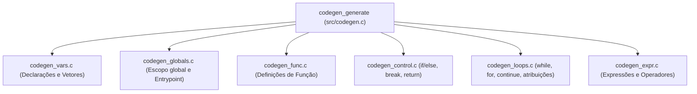

# Geração de Código (Python 3)

Este documento detalha a última etapa da pipeline do compilador: a **transpilação da AST validada para código Python 3** executável e legível (seguindo indentação PEP 8 de 4 espaços por nível).

---

## 1. Arquitetura Modular

O gerador de código é orquestrado por `src/codegen.c` (`codegen_generate`) e dividido em módulos especializados, cada um com sua própria suíte de testes unitários em C:



| Módulo | Responsabilidade |
|---|---|
| `src/codegen.c` / `src/codegen.h` | Contexto de geração (`CodegenContext`), despachante de comandos (`emit_statement`) e ponto de entrada `codegen_generate()`. |
| `src/codegen_vars.c` | Emissão de variáveis locais/globais com valores padrão, inicializadores escalares, vetores estáticos (`[default] * N`) e `char[]` inferido (`list("...")`). |
| `src/codegen_globals.c` | Detecção automática de globais atribuídas sem sombreamento por parâmetros/locais (`global x, y`) e emissão do bloco `if __name__ == '__main__':`. |
| `src/codegen_func.c` | Emissão de `def nome(p1, p2):` e emissão de `pass` em corpos vazios. |
| `src/codegen_control.c` | Emissão de `if`, `else`, `break` e `return` com indentação Python. |
| `src/codegen_loops.c` | Emissão de `while`, conversão estruturada de `for` em `while`, preservação do passo do `for` em `continue` e atribuições (`=`, `+=`, `-=`, `*=`, `/=`, `//=`). |
| `src/codegen_expr.c` | Emissão de literais, chamadas, acesso a vetores e expressões unárias/binárias preservando precedência com parênteses. |

---

## 2. Regras de Tradução (C → Python 3)

### Tipos e Valores Padrão
Quando uma variável é declarada sem inicializador, o gerador atribui o valor padrão correspondente ao seu tipo em C:

| Tipo em C | Valor Padrão em Python | Vetor `T v[N]` |
|---|---|---|
| `int` | `0` | `[0] * N` |
| `float` | `0.0` | `[0.0] * N` |
| `char` | `''` | `[''] * N` |
| `bool` | `False` | `[False] * N` |
| `char s[] = "texto"` | `list("texto")` | — |

### Operadores e Expressões
- **Divisão inteira vs. real:** `/` e `/=` entre dois operandos `int` são emitidos como `//` e `//=`; quando pelo menos um operando é `float`, são emitidos como `/` e `/=`.
- **Operadores lógicos e booleanos:** `&&` → `and`, `||` → `or`, `!` → `not`, `true` → `True`, `false` → `False`.
- **Precedência:** Operações binárias e unárias são emitidas entre parênteses, garantindo equivalência exata com a AST construída pelo Bison.

### Controle de Fluxo e Laços
- **Laço `for`:** Traduzido para `inicializacao` seguida de `while cond:` (ou `while True:` quando a condição é omitida) com o `passo` ao final do corpo.
- **`continue` em laços `for`:** Como o `continue` de C executa o passo antes da próxima iteração, o gerador mantém uma pilha de passos ativos (`loop_steps`) e emite o passo do `for` mais interno imediatamente antes de `continue`.
- **Corpos vazios:** Funções ou laços sem comandos emitem `pass` para manter a sintaxe Python válida.

### Variáveis Globais e Ponto de Entrada
- Dentro de cada função, `codegen_emit_function_globals` analisa quais variáveis globais sofrem atribuição sem serem sombreadas por parâmetros ou variáveis locais daquela função, emitindo `global var1, var2` no início do corpo.
- Ao final do arquivo gerado, é emitido o ponto de entrada padrão:
  ```python
  if __name__ == '__main__':
      import sys
      sys.exit(main())
  ```

---

## 3. Uso via CLI e Testes

```bash
# Imprimir código Python 3 no terminal
./compilador -g programa.c

# Salvar em arquivo e executar
./compilador -o saida.py programa.c
python3 saida.py
```

A validação é feita por **48 testes end-to-end** em `tests/test_codegen.py` (executados via `make test`) e **6 suítes unitárias em C** (`tests/test_codegen_*.c`).
