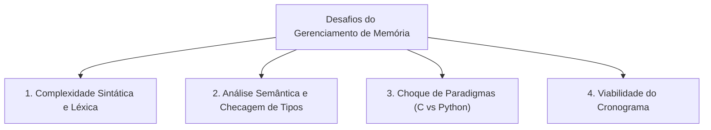

# Decisões de Projeto

Este documento registra as principais decisões de arquitetura e escopo tomadas pela equipe ao longo do desenvolvimento do compilador, servindo como registro histórico das motivações técnicas, alternativas consideradas e justificativas para os caminhos adotados.

---

## 1. Não Implementação de Gerenciamento de Memória e Ponteiros

### Status
**Aprovado e Adotado** (Sprint 1 / Sprint 2)

---

### Contexto
O projeto consiste na construção de um compilador cuja linguagem fonte é um subconjunto de **C** e cuja linguagem alvo final é **Python**. Durante a concepção da linguagem e o planejamento das sprints, a equipe avaliou a viabilidade de incluir suporte a ponteiros (`*ptr`, `&var`, `p->campo`), aritmética de ponteiros e gerenciamento dinâmico de memória (`malloc`, `calloc`, `free`).

Após análise técnica detalhada, a equipe deliberou por **não implementar** manipulação direta de ponteiros nem alocação dinâmica de memória no escopo do projeto, restringindo a linguagem a variáveis primitivas e vetores (`arrays`) com tamanho estático.

---

### Por que a manipulação de memória é tão difícil?

A manipulação de memória de baixo nível é um dos aspectos mais desafiadores da teoria e prática da construção de compiladores. A decisão de excluí-la decorreu de quatro fatores de alta complexidade técnica:

#### 1. Mismatch de Paradigmas de Memória (C → Python)
A principal dificuldade reside no abismo conceitual entre o modelo de memória de C e o de Python:

- **Modelo de C:** Memória linear, contígua e exposta diretamente como endereços numéricos em bytes. O programador controla o ciclo de vida de objetos no *stack* (pilha) e no *heap*, operando diretamente sobre ponteiros de memória.
- **Modelo de Python:** Memória totalmente abstraída e gerenciada por *Garbage Collector* (contagem de referências e detecção de ciclos). Não existem ponteiros físicos, aritmética de endereços nem liberação manual de blocos de memória na sintaxe do Python.

Traduzir operações como aritmética de ponteiros (`p + 2`, `*(ptr++)`) para Python exigiria que o nosso compilador implementasse uma **máquina virtual inteira de memória emulado** (como um array global de bytes em Python simulando uma RAM com offsets numéricos). Isso descaracterizaria o código Python gerado, tornando-o ininteligível, ineficiente e nada idiomático.

Além disso, primitivas como `free(ptr)` não possuem equivalente direto em Python, pois a linguagem não permite destruição forçada de memória em runtime.

#### 2. Complexidade na Análise Semântica e Sistema de Tipos
Implementar ponteiros multiplicaria a complexidade do analisador semântico de forma desproporcional:

- **Indireção Multinível:** O sistema de tipos precisaria suportar tipos recursivos com múltiplos níveis de indireção (`int*`, `int**`, `char***`), compatibilidade de ponteiros void (`void*`) e checagens estritas de coerção.
- **Aritmética de Ponteiros Dependente de Tamanho:** A expressão `ptr + 1` não soma 1 byte, mas sim `sizeof(*ptr)`. Isso exigiria que a tabela de símbolos e o verificador de tipos calculassem layouts de memória precisos de tipos primitivos e estruturas compostas, considerando alinhamento de memória (*padding*).
- **Semântica de *l-values* e *r-values*:** Distinguir atribuições de ponteiro (`p = q;`), atribuições de valor apontado (`*p = *q;`) e obtenção de endereço (`p = &x;`), prevenindo estados ilegais como criar ponteiros para expressões literais temporárias (`&10;`).

#### 3. Ambiguidade e Sobrecarga Sintática
A inclusão de ponteiros introduz ambiguidades que complicam a gramática do Bison (`parser.y`):

- O símbolo `*` atua como operador binário de multiplicação (`a * b`), operador unário de desreferenciação (`*p`) e declarador de tipo (`int *p;`). Em declarações complexas ou expressões com cast, resolver esses conflitos na gramática BNF/EBNF exige regras auxiliares extensas para evitar conflitos de *shift/reduce*.
- O operador `&` colide entre o operador unário de endereço (*address-of*) e o operador bitwise binário.

#### 4. Segurança e Risco ao Cronograma
Lidar com ponteiros sem um sistema avançado de análise de fluxo estático abre espaço para erros críticos em tempo de execução:
- Desreferenciação de ponteiro nulo (*null pointer dereference*).
- Ponteiros soltos (*dangling pointers*) decorrentes de descarte prematuro com `free`.
- Vazamentos de memória (*memory leaks*).

---

## 2. Podagem de Escopo para Viabilidade da Transpilação (Corte de Structs, Switch e Shadowing)

### Status
**Aprovado e Adotado** (Sprint 3)

---

### Contexto e Motivação
Com a conclusão do front-end básico e a preparação da etapa de **Geração de Código (Transpilação de AST para Python)** escrita em C puro, a equipe reavaliou a viabilidade técnica de manter construções que introduziam discrepâncias semânticas severas entre C e Python:

1. **`struct` (Registros Heterogêneos):**
   - Em C, a atribuição `p2 = p1` ou passagem de structs em funções copia todos os campos por valor. Em Python, objetos de classe são referências compartilhadas e mutáveis. Para manter a semântica de cópia de C sem efeitos colaterais silenciosos, o gerador de código precisaria implementar clonagem profunda automática (`copy.copy` ou construtores de cópia) e emitir definições de classe Python antes do programa.
2. **`switch / case / default`:**
   - Em C, o `switch` possui comportamento de *fall-through* implícito na ausência de `break`. O Python não possui esse comportamento nativo (nem no `match-case` do Python 3.10). Além disso, um `break` de `switch` em C não é válido como `break` em Python se transpilado para `if/elif/else`. O comando `if/else` já atende com rigor total o requisito didático de seleção condicional.
3. **Arrays Multidimensionais:**
   - Gerar alocações de listas aninhadas em Python dinamicamente via C (`[[0]*col for _ in range(lin)]`) eleva a complexidade de manipulação de strings em C sem ganho conceitual adicional em relação a vetores unidimensionais.
4. **Sombreamento de Variáveis (*Shadowing*):**
   - C possui escopo de bloco léxico (`{ int x; }`), enquanto Python possui escopo em nível de função. Para contornar essa diferença, o compilador seria obrigado a implementar *Alpha-Renaming* (mangling de identificadores como `x_0`, `x_1`), mantendo tabelas de mapeamento e renomeando nós de expressões na emissão. Proibir o shadowing permite que o gerador de código emita diretamente o nome original de cada variável (`fprintf(out, "%s", node->name)`).

---

### Tabela Comparativa de Decisões de Escopo

| Recurso em C | Decisão | Alternativa Implementada no Compilador |
|---|---|---|
| **Alocação Dinâmica** (`malloc`/`free`) | Não implementado | Alocação automática/estática |
| **Ponteiros** (`*ptr`, `&var`, `p->campo`) | Não implementado | Variáveis escalares acessadas diretamente pelo identificador |
| **Estruturas Heterogêneas** (`struct`) | Podado do escopo | Variáveis primitivas e vetores |
| **Seleção Múltipla** (`switch`) | Podado do escopo | Seleção condicional com `if` e `if-else` |
| **Arrays Multidimensionais** | Podado do escopo | Vetores unidimensionais estáticos (`int v[N]`) |
| **Sombreamento de Variáveis** (*Shadowing*) | Proibido no semântico | Nomes de variáveis locais únicos por função |
| **Passagem de Parâmetros** | Simplificada | Passagem por valor para tipos primitivos e vetores 1D |

---

### Conclusão e Benefícios
Essa refatoração garantiu que:
1. O compilador permaneça com **zero vazamentos de memória e 100% de testes automatizados aprovados**;
2. A Tabela de Símbolos e a AST fiquem diretamente alinhadas à arquitetura do futuro gerador de código (`src/codegen.c`);
3. A equipe possa implementar o gerador de código manualmente em C de forma limpa, direta e depurável.
